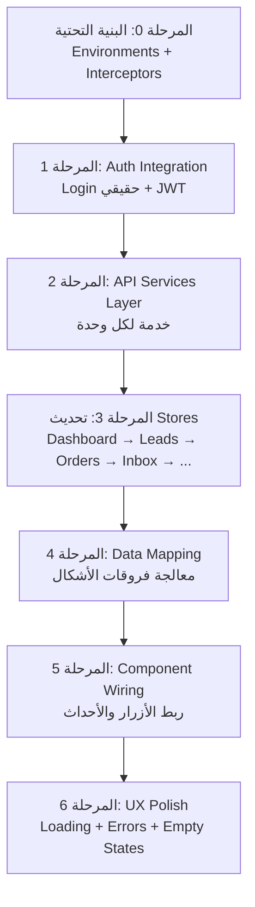

# 🔗 خطة ربط الفرونت اند (Angular) بالباكند (NestJS) — orca CRM

## الوضع الحالي

### الباكند (NestJS) — جاهز ✅
جميع الوحدات مبنية ومختبرة: Auth, Customers, Leads, Orders, Devices, Payments, Notifications, Conversations, Performance, AuditLog, Dashboard, Health.

### الفرونت اند (Angular) — يعمل على Mock Data 🟡
كل الشاشات مبنية ومصممة، لكن البيانات مضمّنة (hardcoded) داخل ملفات الـ `SignalStore` في كل Feature.

| الشاشة | ملف الـ Store الحالي | حالة البيانات |
|---|---|---|
| Dashboard | `dashboard.store.ts` | Mock data مضمّن |
| Leads | `leads.store.ts` | Mock data مضمّن (401 سطر) |
| Orders | `orders.store.ts` | Mock data مضمّن (692 سطر) |
| Inbox | `inbox.store.ts` | Mock data مضمّن (528 سطر) |
| Notifications | `notifications.store.ts` | Mock data مضمّن (172 سطر) |
| Performance | `performance.store.ts` | Mock data مضمّن (904 سطر) |
| Login | `login.ts` | يستخدم `dummy_token` فقط |
| Auth Guard | `auth.guard.ts` | يعتمد على `isLoggedIn` من `AuthStore` |

---

## المراحل المطلوبة

---

### المرحلة 0: البنية التحتية للاتصال (Foundation Layer)
> **الهدف:** تجهيز Angular للتواصل مع الباكند بشكل آمن ومركزي.

#### 0.1 — إعداد Environment Configuration
إنشاء ملفات البيئة لتحديد عنوان الـ API:

```
src/environments/
├── environment.ts          → apiUrl: 'http://localhost:3000'
└── environment.prod.ts     → apiUrl: 'https://api.orca-crm.com'
```

#### 0.2 — إنشاء HTTP Interceptors (`src/app/core/interceptors/`)

| الملف | الوظيفة |
|---|---|
| `auth.interceptor.ts` | يضيف `Authorization: Bearer <token>` لكل طلب تلقائياً |
| `tenant.interceptor.ts` | يضيف `X-Tenant-ID` من سياق المستخدم المسجّل |
| `error.interceptor.ts` | يلتقط أخطاء 401/403/500 ويعالجها (إعادة توجيه لصفحة Login عند انتهاء الجلسة) |

> ⚠️ **قاعدة غير قابلة للنقاش:** لا يوجد أي `HttpClient.get/post` مباشر في أي Component أو Store — كل الطلبات تمر عبر الـ Interceptors.

#### 0.3 — تسجيل Interceptors في `app.config.ts`

```typescript
provideHttpClient(
  withInterceptors([authInterceptor, tenantInterceptor, errorInterceptor])
)
```

---

### المرحلة 1: نظام تسجيل الدخول الحقيقي (Auth Integration)
> **الهدف:** استبدال `dummy_token` بنظام JWT حقيقي.

#### الملفات المتأثرة:

| الملف | التغيير |
|---|---|
| [`auth.service.ts`](file:///f:/apps/orca/crm/src/app/core/services/auth.service.ts) | استبدال `login()` الوهمي بـ `POST /auth/login` حقيقي، وتخزين JWT Token |
| [`auth.store.ts`](file:///f:/apps/orca/crm/src/app/core/state/auth.store.ts) | تحديث الـ State لتشمل `user`, `token`, `tenantId` بدلاً من `dummy_token` |
| [`login.ts`](file:///f:/apps/orca/crm/src/app/features/auth/login/login.ts) | ربط `onSubmit()` بالـ `AuthService.login()` الحقيقي بدلاً من `setTimeout` |
| [`auth.guard.ts`](file:///f:/apps/orca/crm/src/app/core/guards/auth.guard.ts) | التحقق من صلاحية الـ Token (وليس فقط وجوده) |

#### التدفق الجديد:
```
Login Form → POST /auth/login (email, password)
           → Backend يرد بـ { access_token, user: { id, name, role, tenant_id } }
           → Angular يحفظ Token في localStorage
           → AuthStore يُحدَّث بـ { isLoggedIn: true, user, token, tenantId }
           → Redirect إلى /dashboard
```

#### الـ Interfaces الجديدة (`src/app/core/models/auth.models.ts`):
```typescript
interface LoginRequest { email: string; password: string; }
interface LoginResponse { access_token: string; user: AuthUser; }
interface AuthUser { id: string; name: string; email: string; role: string; tenant_id: string; }
```

---

### المرحلة 2: طبقة خدمات API (`src/app/core/services/api/`)
> **الهدف:** إنشاء خدمة (Service) مقابل كل وحدة باكند، مسؤولة فقط عن الاتصال بالـ API.

#### بنية الملفات:
```
src/app/core/services/api/
├── customers-api.service.ts
├── leads-api.service.ts
├── orders-api.service.ts
├── devices-api.service.ts
├── payments-api.service.ts
├── notifications-api.service.ts
├── conversations-api.service.ts
├── performance-api.service.ts
├── dashboard-api.service.ts
└── audit-log-api.service.ts
```

#### خريطة الربط (API Mapping):

##### `leads-api.service.ts`
| الدالة في الخدمة | Endpoint في الباكند | الاستخدام في الـ Frontend |
|---|---|---|
| `getAll()` | `GET /leads` | شاشة Leads (Kanban + Table) |
| `getById(id)` | `GET /leads/:id` | تفاصيل Lead |
| `create(dto)` | `POST /leads` | إضافة Lead جديد |
| `update(id, dto)` | `PATCH /leads/:id` | تعديل بيانات Lead |
| `updateStage(id, stage)` | `PATCH /leads/:id/stage` | نقل Lead بين أعمدة Kanban |
| `delete(id)` | `DELETE /leads/:id` | حذف Lead |
| `addNote(id, note)` | `POST /leads/:id/notes` | إضافة ملاحظة |

##### `orders-api.service.ts`
| الدالة في الخدمة | Endpoint في الباكند | الاستخدام في الـ Frontend |
|---|---|---|
| `getAll()` | `GET /orders` | شاشة Orders (الجدول الرئيسي) |
| `getById(id)` | `GET /orders/:id` | تفاصيل الطلب |
| `create(dto)` | `POST /orders` | Order Wizard (إنشاء طلب جديد) |
| `update(id, dto)` | `PATCH /orders/:id` | تعديل طلب |

##### `devices-api.service.ts`
| الدالة في الخدمة | Endpoint في الباكند | الاستخدام في الـ Frontend |
|---|---|---|
| `search(dto)` | `POST /devices/search` | البحث بأمان (MAC, DeviceKey) |
| `updateStatus(id, status)` | `PATCH /devices/:id/status` | تغيير حالة الجهاز |

##### `conversations-api.service.ts`
| الدالة في الخدمة | Endpoint في الباكند | الاستخدام في الـ Frontend |
|---|---|---|
| `search(filters)` | `POST /conversations/search` | شاشة Inbox (قائمة المحادثات) |
| `getById(id)` | `GET /conversations/:id` | تفاصيل المحادثة مع الرسائل |
| `sendMessage(id, dto)` | `POST /conversations/:id/messages` | إرسال رسالة |
| `assign(id, userId)` | `PATCH /conversations/:id/assign` | تحويل المحادثة |

##### `notifications-api.service.ts`
| الدالة في الخدمة | Endpoint في الباكند | الاستخدام في الـ Frontend |
|---|---|---|
| `getMyNotifications(filters)` | `GET /notifications/my-notifications` | شاشة الإشعارات |
| `markAsRead(id)` | `PATCH /notifications/:id/read` | تعليم إشعار كمقروء |
| `markAllAsRead()` | `PATCH /notifications/read-all` | تعليم الكل كمقروء |

##### `performance-api.service.ts`
| الدالة في الخدمة | Endpoint في الباكند | الاستخدام في الـ Frontend |
|---|---|---|
| `getKpis(filter)` | `GET /performance/kpis` | مؤشرات الأداء |
| `getLeaderboard(filter)` | `GET /performance/leaderboard` | ترتيب الموظفين |

##### `dashboard-api.service.ts`
| الدالة في الخدمة | Endpoint في الباكند | الاستخدام في الـ Frontend |
|---|---|---|
| `getSummary(filter)` | `GET /dashboard/summary` | لوحة التحكم الرئيسية (KPIs + Funnel + Activity) |

---

### المرحلة 3: تحديث الـ Stores (استبدال Mock Data بـ API Calls)
> **الهدف:** تحويل كل SignalStore من بيانات مضمّنة إلى بيانات حقيقية من الـ API.

#### النمط الموحد لكل Store:

```typescript
// قبل (Mock):
const initialState = { leads: [/* 200 سطر mock data */], isLoading: false };

// بعد (Real API):
const initialState = { leads: [], isLoading: false, error: null };

export const LeadsStore = signalStore(
  { providedIn: 'root' },
  withState(initialState),
  withMethods((store, leadsApi = inject(LeadsApiService)) => ({
    loadLeads() {
      patchState(store, { isLoading: true });
      leadsApi.getAll().subscribe({
        next: (leads) => patchState(store, { leads, isLoading: false }),
        error: (err) => patchState(store, { error: err.message, isLoading: false })
      });
    },
    // ... باقي الدوال
  }))
);
```

#### ترتيب تحديث الـ Stores (حسب الأولوية):

| الأولوية | الـ Store | السبب |
|---|---|---|
| 🔴 1 | `auth.store.ts` | بوابة الدخول — بدون Auth حقيقي لا يمكن اختبار أي شيء |
| 🔴 2 | `dashboard.store.ts` | أول شاشة يراها المستخدم بعد الدخول |
| 🟠 3 | `leads.store.ts` | الأكثر تعقيداً (Kanban + Table + Notes + Stage Changes) |
| 🟠 4 | `orders.store.ts` | ثاني أكثر تعقيداً (Wizard + Detail View + Device Management) |
| 🟡 5 | `inbox.store.ts` | الرسائل والمحادثات |
| 🟡 6 | `notifications.store.ts` | الإشعارات |
| 🟢 7 | `performance.store.ts` | التقارير والإحصائيات |

---

### المرحلة 4: معالجة فروقات الـ Data Shape (Data Mapping)
> **الهدف:** مطابقة الـ Interfaces بين ما يرسله الباكند وما يتوقعه الفرونت اند.

#### الفروقات المعروفة التي تحتاج معالجة:

| الكيان | الفرونت اند يتوقع | الباكند يرسل | الحل المطلوب |
|---|---|---|---|
| **Lead** | `badgeText`, `badgeIcon`, `badgeType`, `repName` | لا يرسلها (مشتقة) | حسابها في الـ `LeadsStore` عبر `withComputed()` |
| **Order** | `statusLabel`, `customerInitials`, `expiryWarningDays` | لا يرسلها (مشتقة) | حسابها في الـ `OrdersStore` |
| **Conversation** | `initial`, `timeAgo`, `statusLabel`, `categoryLabel` | لا يرسلها | حسابها في الـ `InboxStore` أو Pipe |
| **Notification** | `groupDate`, `tags`, `actionLabel` | لا يرسلها | حسابها في الـ `NotificationsStore` |
| **Performance** | `summaryMetrics[]`, `employees[]`, `channelTrendPoints[]` — هيكل معقد جداً | `{ totalRevenue, totalOrders, ... }` | إنشاء **Mapper/Transformer** مخصص |

> [!IMPORTANT]
> شاشة **Performance** هي الأكثر تعقيداً من حيث الفجوة بين ما يرسله الباكند وما يتوقعه الفرونت. ستحتاج إما لتوسيع الـ API أو بناء طبقة تحويل (Mapper) في الفرونت.

---

### المرحلة 5: تحديث مكونات الـ UI (Component-Level Wiring)
> **الهدف:** ربط الأزرار والأحداث (Events) في الـ Components بدوال الـ Store الجديدة.

#### التغييرات المطلوبة:

| الشاشة | التغييرات |
|---|---|
| **Login** | `onSubmit()` يستدعي `authStore.login(email, password)` بدلاً من `setTimeout` |
| **Dashboard** | يستدعي `dashboardStore.loadSummary()` عند `ngOnInit` |
| **Leads** | سحب وإفلات Kanban يستدعي `leadsStore.updateStage(id, newStage)` → API |
| **Leads** | إضافة ملاحظة تستدعي `leadsStore.addNote(id, text)` → API |
| **Orders** | Order Wizard Step 4 (التأكيد) يستدعي `ordersStore.createOrder(dto)` → API |
| **Inbox** | إرسال رسالة يستدعي `inboxStore.sendMessage(convId, text)` → API |
| **Notifications** | زر "تعليم الكل كمقروء" يستدعي `notificationsStore.markAllAsRead()` → API |

---

### المرحلة 6: Loading States و Error Handling في الـ UI
> **الهدف:** تجربة مستخدم سلسة أثناء انتظار البيانات أو حدوث أخطاء.

#### المطلوب:
1. **Skeleton Loaders:** عرض هيكل وهمي (skeleton) أثناء تحميل البيانات لأول مرة
2. **Empty States:** عرض رسالة مناسبة عند عدم وجود بيانات ("لا توجد عملاء محتملون بعد")
3. **Error States:** عرض رسالة خطأ واضحة مع زر "إعادة المحاولة"
4. **Optimistic Updates:** تحديث الـ UI فوراً (مثلاً عند نقل Lead في الـ Kanban) ثم التراجع إذا فشل الـ API

---

## ملخص الملفات الجديدة والمعدّلة

### ملفات جديدة (≈ 15 ملف):
```
src/environments/environment.ts
src/environments/environment.prod.ts
src/app/core/interceptors/auth.interceptor.ts
src/app/core/interceptors/tenant.interceptor.ts
src/app/core/interceptors/error.interceptor.ts
src/app/core/models/auth.models.ts
src/app/core/services/api/customers-api.service.ts
src/app/core/services/api/leads-api.service.ts
src/app/core/services/api/orders-api.service.ts
src/app/core/services/api/devices-api.service.ts
src/app/core/services/api/payments-api.service.ts
src/app/core/services/api/notifications-api.service.ts
src/app/core/services/api/conversations-api.service.ts
src/app/core/services/api/performance-api.service.ts
src/app/core/services/api/dashboard-api.service.ts
src/app/core/services/api/audit-log-api.service.ts
```

### ملفات معدّلة (≈ 12 ملف):
```
src/app/app.config.ts                              → تسجيل Interceptors + provideHttpClient
src/app/core/services/auth.service.ts               → HTTP Login حقيقي
src/app/core/state/auth.store.ts                    → JWT State + user info
src/app/core/guards/auth.guard.ts                   → Token validation
src/app/features/auth/login/login.ts                → ربط بـ AuthService الحقيقي
src/app/features/dashboard/state/dashboard.store.ts → API بدلاً من Mock
src/app/features/leads/state/leads.store.ts         → API بدلاً من Mock
src/app/features/orders/store/orders.store.ts       → API بدلاً من Mock
src/app/features/inbox/store/inbox.store.ts         → API بدلاً من Mock
src/app/features/notifications/store/notifications.store.ts → API بدلاً من Mock
src/app/features/performance/store/performance.store.ts     → API بدلاً من Mock
src/app/features/settings/store/settings.store.ts           → API (إذا لزم)
```

---

## ترتيب التنفيذ المقترح



---

## ⏱️ تقدير الوقت

| المرحلة | الوقت التقريبي |
|---|---|
| المرحلة 0: البنية التحتية | جلسة واحدة |
| المرحلة 1: Auth | جلسة واحدة |
| المرحلة 2: API Services | جلسة واحدة |
| المرحلة 3+4: Stores + Mapping | 2-3 جلسات (الأكثر كثافة) |
| المرحلة 5: Component Wiring | جلسة واحدة |
| المرحلة 6: UX Polish | جلسة واحدة |

---

> [!NOTE]
> هذه الخطة تحافظ على كل التصميمات والشاشات الحالية كما هي — التغيير الوحيد هو **مصدر البيانات** (من Mock إلى API حقيقي). لن يتأثر أي تصميم أو Layout.
